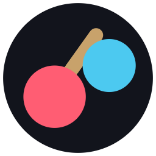
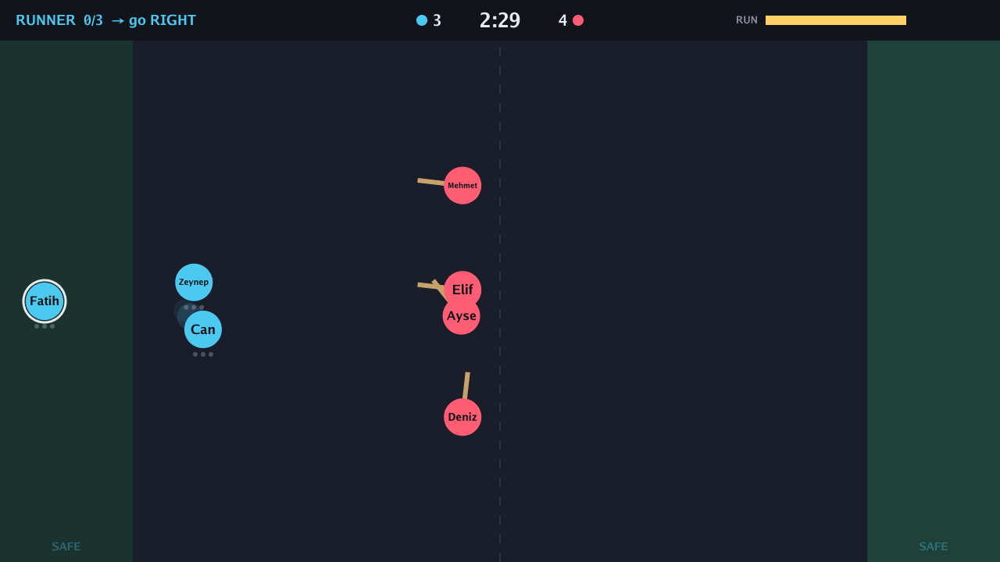
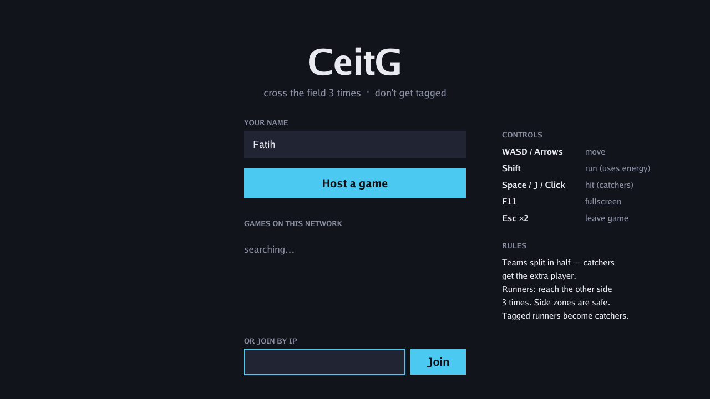
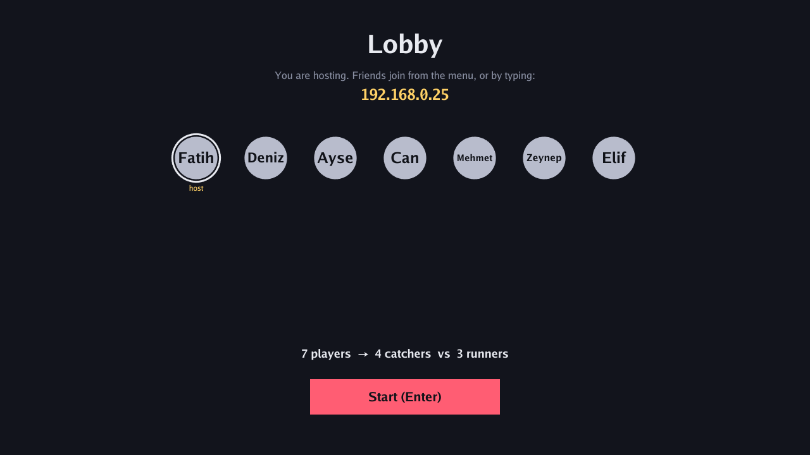

<div align="center">



# CeitG

**A tiny 2D tag game for your classroom.**<br>
Cross the field 3 times. Don't get tagged.

[](https://github.com/faithere1/CeitG/releases/latest/download/CeitG-Windows.zip)
[](https://github.com/faithere1/CeitG/releases/latest/download/CeitG-macOS.zip)




</div>

---

## ✨ What is it?

CeitG is a 2D LAN game inspired by Roblox's *Huss Valley*. One friend hosts and everyone else joins over the same Wi-Fi. There are no accounts, no internet, and nothing to install. It runs fine on old school PCs too, using about 3% of one CPU core.

## 🎮 How to play

| | Team | Goal |
|---|---|---|
| 🔵 | **Runners** | Start in the left safe zone and reach the other side **3 times** (→ ← →). **Dash** past catchers! |
| 🔴 | **Catchers** | Swing the stick to tag runners. Tagged runners **become catchers**. |

- Players split into two teams automatically. If the count is odd, **catchers get the extra player**.
- The green side zones are **safe**, and catchers can't enter them.
- If at least one runner escapes before the **2:30** clock ends, **runners win**. Otherwise, **catchers win**.
- There's **no player limit**. Anyone who joins mid-round watches and plays next round.

### Controls

| Key | Action |
|---|---|
| `W` `A` `S` `D` / Arrows | Move |
| `Shift` | **Run** (drains the energy bar, refills when you stop) |
| `Space` / `J` / Left click | **Catchers:** hit with the stick · **Runners:** dash (a quick burst of speed, 2 s cooldown) |
| `F11` | Fullscreen |
| `Esc` ×2 | Leave the game |

## 🚀 Quick start

1. **Download** the zip for your computer using the buttons above, then unzip it.
2. **Open the app:**
   - **Windows:** double-click `CeitG.exe`. If SmartScreen appears, click *More info → Run anyway*.
   - **macOS:** move `CeitG.app` to Applications, then the first time **right-click → Open → Open** (the app isn't Apple-signed).
3. **One person** types a name and clicks **Host a game**. When the firewall asks, click **Allow**.
4. **Everyone else** clicks the host's game under *Games on this network*.
5. The host presses **Start**. Have fun!

<table>
<tr>
<td></td>
<td></td>
</tr>
<tr>
<td align="center"><sub>Menu: host or join</sub></td>
<td align="center"><sub>Lobby: the host's IP is shown for manual joining</sub></td>
</tr>
</table>

## 🛠 Troubleshooting

<details>
<summary><b>The host's game doesn't show up in the list</b></summary>

Some school networks block discovery broadcasts. Type the IP shown in the host's lobby into **Join by IP** instead.
</details>

<details>
<summary><b>Can't connect at all</b></summary>

- Everyone must be on the **same network**. Guest Wi-Fi often isolates devices from each other.
- The host's firewall must allow CeitG (TCP `47800`, UDP `47801`). On Windows, allow it on **Private networks**.
- Fallback: connect everyone to one phone's **hotspot**.
</details>

<details>
<summary><b>macOS says the app is damaged or can't be opened</b></summary>

Right-click the app → **Open**. If that doesn't work, run this in Terminal:

```sh
xattr -dr com.apple.quarantine /Applications/CeitG.app
```
</details>

## 🧑‍💻 Build from source

Needs [Go 1.26+](https://go.dev/dl/) on a Mac (with Xcode command line tools for the macOS build):

```sh
sh scripts/build.sh   # → dist/CeitG-macOS.zip + dist/CeitG-Windows.zip
go test ./...         # game-rules test
```

| File | What's inside |
|---|---|
| `server.go` | Game rules. The host runs the real game; everyone else sends their keys. |
| `client.go` | Network connection to the host |
| `discovery.go` | Finds games on the local network (UDP broadcast) |
| `main.go` / `draw.go` | Menus, input, and drawing |

Built with [Ebitengine](https://ebitengine.org) in Go.
